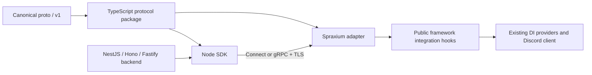
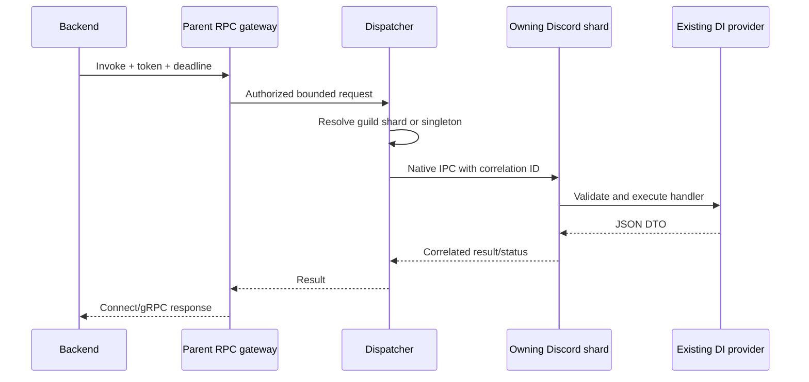

# System design

## Ownership and dependency direction

`protocol` depends only on Protobuf ES. `client` depends on the protocol and Connect libraries. Only the bot adapter uses the framework and Discord.js. Framework core has no RPC dependency. There is no RPC DI container, HTTP controller framework, broker, database or generated service per application handler.

The stable envelope contains a method name and UTF-8 JSON bytes. Application-owned contracts describe custom payloads; application handlers validate them at runtime. Generic TypeScript contracts improve editor checks but cannot provide cross-language application schema validation. Applications needing generated domain DTOs can maintain their own separate schemas.

## Direct mode

1. A backend authenticates its user and checks application permissions.
2. The SDK sends an authenticated unary call with a deadline and cancellation signal.
3. The gateway bounds the envelope, authenticates the token and applies its rate/concurrency limits.
4. The registry checks the handler's explicit permissions and validates its input.
5. The executor calls the already constructed provider instance and serializes a plain JSON result.

Applications import the global `RpcModule` and configure `defineRpc` in the normal plugins array. The registry, configuration resolver, framework host and runtime lifecycle are native DI providers. An internal instance hook buffers discovery until the registry exists, preserving handlers in feature modules loaded before RPC. The listener opens only after every application `onReady` finishes. Shutdown stops admission and drains RPC before provider shutdown. State is scoped to one application instance.

## Native shard mode

The parent hosts one network listener and constructs no application providers. Workers discover handlers from their own DI instances. Their manifests must agree before the dispatcher becomes ready. Guild calls use Discord's snowflake shard formula; singleton calls use the configured shard. The dispatcher sends to exactly one worker, checks reply origin and propagates cancellation. It never broadcasts, retries execution or sends evaluable code.

Worker death marks that shard unavailable and rejects its pending calls. Readiness/respawn refreshes its manifest before admission. Active work is bounded by payload, deadline, concurrency and rate limits. These are local limits per gateway/worker, not distributed quotas.

## Delivery and failure semantics

- Calls are unary. Streaming and asynchronous events are outside v1; Signal remains a separate subsystem.
- No application retries occur automatically. Network ambiguity does not imply that a mutation failed to execute. Idempotent mutation keys, when needed, belong to application state with durable deduplication.
- Cancellation is cooperative. A handler must observe `context.signal`; the executor retains its concurrency slot until an uncooperative handler settles.
- IPC correlation and the worker's bounded deadline-scoped deduplication prevent duplicate execution inside that dispatch path. They do not promise exactly-once delivery across restarts or separate client calls.
- Explicit `RpcError` messages are public. Unexpected handler failures become redacted standard status codes. Payloads, credentials and raw exceptions are not logged.
- Graceful shutdown is bounded. Requests still active after grace are cancelled and network sessions close.

## Deployment and scale

Deploy the external API separately from the Discord application. Use TLS on the gateway or an explicitly trusted TLS termination proxy on a private hop. Tokens are backend service credentials; never expose them to browsers.

One gateway manages one native Discord shard group. Adding replicas of the gateway does not create shared ownership or distributed routing. To span hosts, partition shard groups explicitly and provide ownership-aware routing at the application boundary. A broker/control plane is a later design decision requiring durable routing and ownership semantics; adding Redis alone would not provide them.

Completion logs contain request IDs, registered method names, duration and status. They exclude payloads and bearer metadata.
